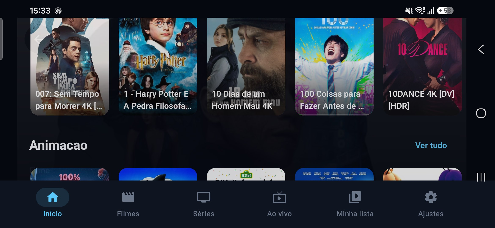
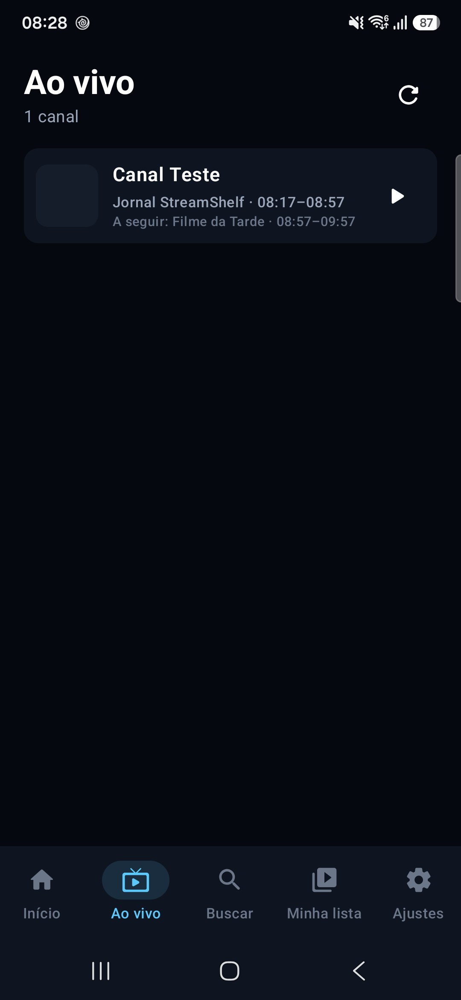
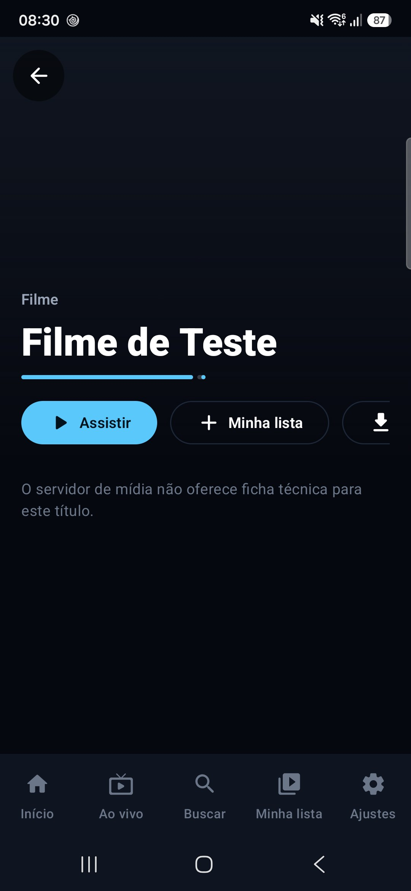
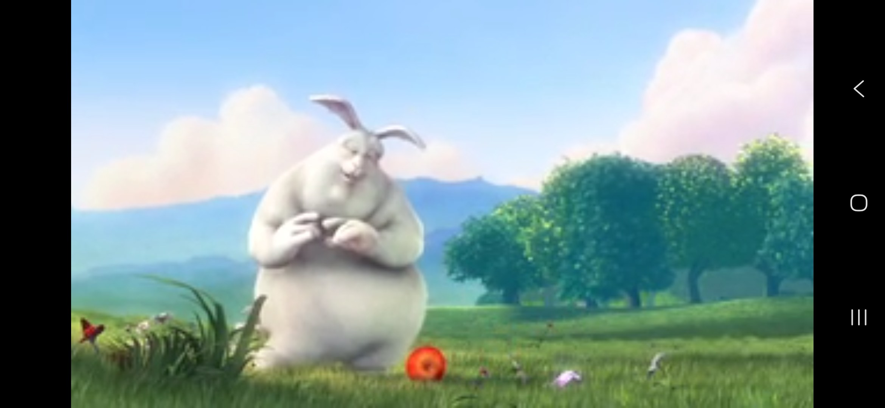
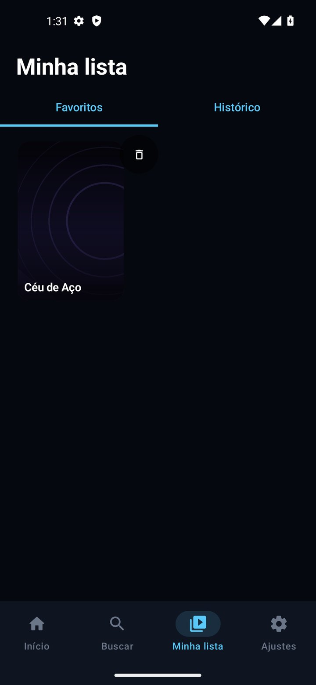
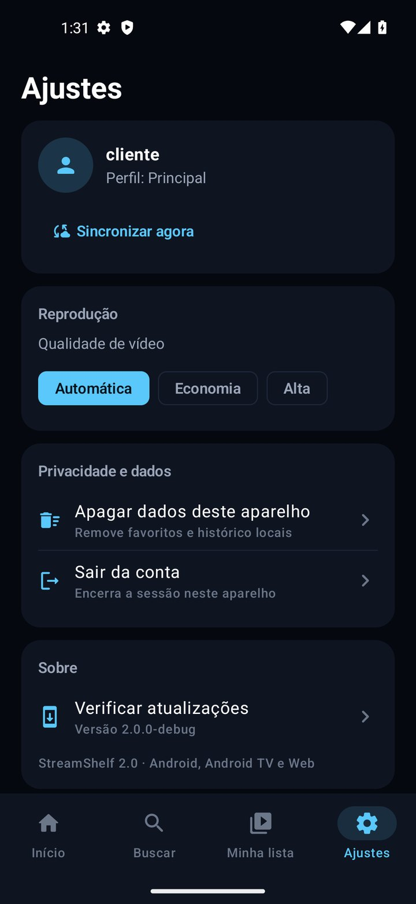
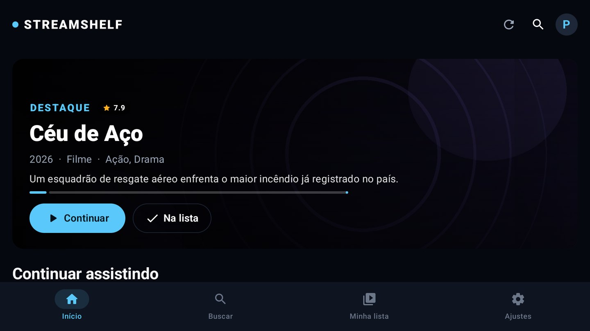

# StreamShelf

**Sua biblioteca de streaming organizada em um só lugar.**

Canais ao vivo, filmes e séries a partir da sua própria lista M3U/M3U Plus, com uma experiência de app nativo para Android e Android TV.

---

## Conheça o aplicativo

  
  
  
  

  <b>Home</b> · <b>Ao vivo</b> · <b>Detalhes</b> · <b>Player</b>

Ver mais telas

  
  
  

  Minha lista · Ajustes · Android TV

## Destaques

- **Catálogo organizado** em filmes, séries e canais ao vivo, com categorias e capas.
- **Home por tipo** com destaque, continuar assistindo e prateleiras.
- **Busca** rápida e detalhes com temporadas/episódios.
- **Biblioteca sincronizada** por perfil: favoritos e progresso acompanham a conta.
- **Perfis** com PIN e modo infantil.
- **Bloqueio de categorias** adultas ou indesejadas nos Ajustes.
- **Downloads offline** de filmes e episódios, com pausa e retomada.
- **Guia de programação (EPG)** para canais ao vivo.
- **Player Media3** com HLS/DASH/MP4, legendas, áudio, velocidade, ±10 s, PiP e reprodução em segundo plano para VOD.
- **Android TV** com navegação por controle remoto.
- **Atualização dentro do app**, com download verificado e instalação assistida.

## Instalação

1. Abra a página da [versão mais recente](https://github.com/andiimdevlp/streamshelf-releases/releases/latest).
2. Baixe o arquivo `StreamShelf-x.y.z.apk`.
3. Autorize a instalação para o aplicativo usado no download.
4. Confirme a instalação.

O StreamShelf não é distribuído pela Play Store. Baixe apenas deste repositório oficial.

### Requisitos

- Android 8.0 (API 26) ou superior.
- Conexão com a internet.
- Uma lista M3U/M3U Plus própria e autorizada, configurada pelo operador da sua conta.

### Android TV

O app também roda em Android TV, com foco por controle remoto e layout para a tela grande. O APK é o mesmo do celular.

## Atualizações

Quando uma versão mais nova estiver publicada, o app avisa ao abrir. O APK:

- é baixado apenas do repositório oficial;
- tem tamanho e SHA-256 conferidos;
- tem pacote, versão e assinatura digital verificados antes de abrir o instalador;
- depende da confirmação do usuário no Android para concluir a instalação.

Você também pode verificar manualmente em **Ajustes → Verificar atualizações**.

> O Android pode solicitar permissão para instalar aplicativos de fontes desconhecidas. Essa permissão é usada apenas para a atualização do StreamShelf.

## Segurança do download

- Baixe APKs somente da página oficial de [Releases](https://github.com/andiimdevlp/streamshelf-releases/releases).
- O arquivo `.sha256` publicado junto ao APK permite conferir a integridade.
- Nunca instale versões enviadas por terceiros.
- Releases publicadas não são substituídas silenciosamente.

## Privacidade e dados

- A sessão é armazenada de forma cifrada no Android.
- Favoritos e histórico ficam vinculados ao perfil da conta e sincronizam com o servidor do operador.
- Downloads ficam no armazenamento do aparelho e podem ser removidos pelo app.
- O app não fornece nem hospeda conteúdo; a fonte é definida pelo operador da sua conta.

## Importante

O StreamShelf é um **reprodutor e organizador de mídia**. O projeto não fornece, hospeda, vende ou inclui canais, filmes, séries ou listas. Cada usuário é responsável pelas fontes configuradas e por possuir autorização para acessar o conteúdo.

## Suporte

Ao relatar um problema, informe:

- modelo do aparelho e versão do Android;
- versão do StreamShelf (Ajustes → Sobre);
- descrição do comportamento observado e passos para reproduzir.

Não publique URLs de listas, usuários, senhas, tokens ou arquivos de backup. Para desenvolvedores, o código-fonte e a documentação técnica estão em [streamshelf-code](https://github.com/andiimdevlp/streamshelf-code).

---

  StreamShelf · sua mídia, organizada do seu jeito.

